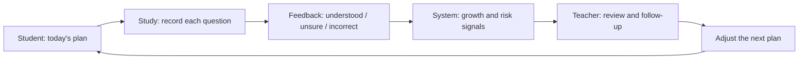

<div align="center">

# AI Study Coach

[简体中文](README.md) · **[English](README.en.md)**

<picture>
  <source media="(max-width: 640px)" srcset="docs/assets/readme-hero-mobile.svg">
  
</picture>

**Connect daily plans, question-level feedback, and teacher follow-up into one learning loop.**

For China's postgraduate entrance exam, Mathematics II · Student app v3.3 · Admin / teacher console v0.11

[Watch the video](#introduction-video) · [Product tour](#product-tour) · [Try it locally](#try-it-before-running-the-full-system) · [Versions](#versions) · [Developer setup](#quick-start)

[](https://github.com/ZhangShixing0/AI-study/actions/workflows/ci.yml)
[](https://github.com/ZhangShixing0/AI-study/releases/tag/v2026.07.21)


</div>

> [!NOTE]
> The product is in **private beta**, with a publicly viewable repository. The video and demo mode use synthetic examples. See [License](#license) for usage rights and [SECURITY.md](SECURITY.md) (Chinese) for production requirements. This English README describes the existing Chinese-language interface.

## Introduction video

In about **2 minutes**, explore the learning loop, student app v3.3, admin / teacher console v0.11, and local setup. Product scenes use synthetic examples from the repository. The video is in Chinese.

https://github.com/user-attachments/assets/df4f9160-ce2e-4735-9acc-44d51d8e8a73

[Full 1080p original (MP4, about 23 MB)](docs/assets/ai-duxue-intro.mp4)

<details>
<summary>Video chapters</summary>

| Time | Topic |
| --- | --- |
| 00:00 | Exam preparation challenges and project introduction |
| 00:20 | The loop: plans, feedback, and teacher follow-up |
| 00:33 | Student app: today's plan, question-level feedback, growth, and weak areas |
| 01:00 | Admin / teacher console and assignment-card tool |
| 01:20 | Architecture, local setup, and release checks |

</details>

## Product tour

From deciding what to study each day to understanding what needs more work. These are actual screens from the student app's built-in demo mode, with synthetic data and a Chinese interface.

<a href="docs/assets/student-experience-tour.png">
  <picture>
    <source media="(max-width: 640px)" srcset="docs/assets/student-experience-mobile.png">
    
  </picture>
</a>

<sub>Click the image for the full view.</sub>

**Students** view plans, submit feedback, and revisit weak areas; **teachers** review progress and follow up. The teacher console and assignment-card tool appear from **01:00** in the video above.

## Try it before running the full system

With Python installed, run this command from the repository root to open the built-in student demo:

```powershell
python -m http.server 8094 --bind 127.0.0.1 --directory prototypes/student-mobile-v3.3
```

Open <http://127.0.0.1:8094/> and click **「立即体验」 (Try now)**.

1. **View the plan**: see today's question types, books, chapters, and question numbers.
2. **Try feedback**: mark answers correct or incorrect, select an error reason, and submit to see completion status and chapter summaries.
3. **Explore growth**: switch to **「成长」 (Growth)** for the study heatmap, chapter mastery, and error analysis.

Demo mode uses static synthetic data in the browser, with no login or database initialization. Feedback is for demonstration only. It does not connect to the teacher console or demonstrate actual learning outcomes. See the [demo guide](docs/experience-guide.md) (Chinese) for details, or [Quick start](#quick-start) to run the full system.

## Versions

**Recommended: v721 · v2026.07.21**

Student app v3.3 / Admin and teacher console v0.11 / Teacher assignment cards v0.1

[Current release](https://github.com/ZhangShixing0/AI-study/releases/tag/v2026.07.21) · [Source for this version](https://github.com/ZhangShixing0/AI-study/tree/v2026.07.21) · [Changelog (Chinese)](CHANGELOG.md)

<details>
<summary>Earlier versions</summary>

| Version | Purpose and link |
| --- | --- |
| v617_MVP | [Main baseline before repository restructuring](https://github.com/ZhangShixing0/AI-study/tree/v617_MVP) |
| v612_MVP | [Earlier MVP snapshot](https://github.com/ZhangShixing0/AI-study/tree/v612_MVP) |
| v609_1 | [Early snapshot](https://github.com/ZhangShixing0/AI-study/tree/v609_1) |

See [Tags](https://github.com/ZhangShixing0/AI-study/tags) for all historical snapshots.

</details>

## What problem does it solve?

AI Study Coach connects planning, feedback, assessment, and follow-up so that each step informs the next, beyond a simple daily check-in:



| Workspace | Main tasks | Current entry point |
| --- | --- | --- |
| **Student app** | Daily plans, question-level feedback, chapter summaries, growth charts, study room, and profile | `http://127.0.0.1:8000/` |
| **Teacher / admin console** | Daily reminders, student and class lookup, read-only follow-up, account and plan administration | `http://127.0.0.1:8000/admin-console/` |
| **Teacher assignment-card tool** | Create shareable daily assignment images from public question data | `standalone/teacher-assignment-card-v0.1/` |

## Current scope

| Component | Version | Responsibility |
| --- | --- | --- |
| FastAPI backend | v721 | API, authentication, business rules, and runtime entry point |
| Student app | v3.3 | Five-page mobile learning loop |
| Admin / teacher console | v0.11 | Administration and teacher workspace; the directory retains v0.1 for compatibility with older deployments |
| Teacher assignment cards | v0.1 | Standalone local tool, excluded from the server deployment package |
| Public Mathematics II seed data | v721 baseline | Question types, questions, chapters, books, and class basics |

Implemented features include role permissions, student sessions, daily plans, question-level feedback, chapter review, growth statistics, TOTP authorization for high-risk actions, public seed validation, PostgreSQL upsert generation, and safe update procedures. See [system architecture](docs/architecture.md) (Chinese) for the full runtime relationships.

## Quick start

### Requirements

- Python 3.13, the version used to validate this release.
- Node.js 22 for the full checks and seed validation.

### Windows PowerShell

```powershell
python -m venv .venv
.\.venv\Scripts\python.exe -m pip install -r requirements.txt
.\.venv\Scripts\python.exe -m backend.seed_db
.\.venv\Scripts\python.exe -m uvicorn backend.main:app --host 127.0.0.1 --port 8000
```

After startup, open:

- Student app: <http://127.0.0.1:8000/>
- Admin / teacher console: <http://127.0.0.1:8000/admin-console/>
- API documentation: <http://127.0.0.1:8000/docs>

Health check:

```powershell
curl.exe http://127.0.0.1:8000/health
```

The response should include:

```json
{"status":"ok","version":"2026.07.21"}
```

## Verify the project

One command runs the Python unit tests, Node contract tests, workbook privacy-metadata checks, production seed validation, and deployment-package rule checks:

```powershell
.\.venv\Scripts\python.exe scripts/run_release_checks.py
```

The v721 release baseline passed **120 Python tests and 44 Node tests**, plus privacy-metadata checks on 24 production seed workbooks.

## Teacher assignment-card tool

```powershell
.\.venv\Scripts\python.exe standalone/teacher-assignment-card-v0.1/build-data.py
Set-Location standalone/teacher-assignment-card-v0.1
python -m http.server 8093 --bind 127.0.0.1
```

Open <http://127.0.0.1:8093/>. The tool reads only the public Mathematics II seed data included in the repository, not student runtime data.

<details>
<summary><strong>Project structure</strong></summary>

```text
backend/                                FastAPI, business services, and backend tests
data/production-seed/                   Public seeds, schemas, and validation reports
data/samples/                           Synthetic local examples
deploy/                                 Packaging, initial deployment, safe updates, and rollback
docs/                                   Architecture, data tables, and product logic
prototypes/student-mobile-v3.3/         Current student app
prototypes/admin-teacher-console-v0.1/  Current admin / teacher console
standalone/teacher-assignment-card-v0.1/ Teacher assignment-card tool
scripts/                                Data, validation, and release helpers
```

</details>

<details>
<summary><strong>Data and security boundaries</strong></summary>

- `.env.production`, databases, SQLite exports, logs, ZIP files, uploads, screenshots, and browser caches are excluded by `.gitignore`.
- `data/samples/` is for synthetic test data only; never replace it with real student exports.
- FastAPI does not expose `data/`, `deploy/`, `docs/`, or server environment files as static directories.
- Routine code updates must not rebuild, clear, or overwrite production PostgreSQL.
- `scripts/sanitize_ooxml_metadata.py` checks Excel author metadata.

Before deployment, read [SECURITY.md](SECURITY.md) and the [production safe-update runbook](deploy/production-safe-update-runbook.md), both in Chinese.

</details>

<details>
<summary><strong>Current limitations</strong></summary>

- The focus is Mathematics II; Mathematics I and III do not yet have equally complete data pipelines.
- The frontend remains plain HTML / CSS / JavaScript without a build system.
- The assignment-card tool is standalone and is not integrated into console navigation or unified authentication.
- Earlier Git history is retained. v721 removed historical screenshots and candidate large images only from the release tree; it did not rewrite history.

</details>

## Contributing

Read [CONTRIBUTING.md](CONTRIBUTING.md) (Chinese) and run the full release checks before submitting changes. Report security issues as described in [SECURITY.md](SECURITY.md) (Chinese).

## License

This repository publicly showcases the project, which remains in private beta. No open-source license is currently granted. Copying, public redistribution, or commercial use requires explicit authorization from the repository owner.
