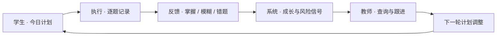

<div align="center">

# AI 督学


**面向考研数学二督学场景，把学生每日执行、逐题反馈和教师运营放进一套可验证的系统。**

[版本中心](#版本中心) · [产品闭环](#项目解决什么问题) · [快速开始](#快速开始) · [系统架构](docs/architecture.md) · [安全说明](SECURITY.md)

[](https://github.com/ZhangShixing0/AI-study/actions/workflows/ci.yml)
[](https://github.com/ZhangShixing0/AI-study/releases/tag/v2026.07.21)


</div>

> [!IMPORTANT]
> 当前项目是**私有内测版本**，不是通用 SaaS。仓库不包含真实学生数据库、生产环境变量、日志、部署备份或截图缓存；生产部署必须使用 PostgreSQL，并在首次启动前设置独立的管理员初始口令。

## 版本中心

当前推荐版本是 **v721**。这是整理后的统一发布入口，包含学生端、管理/教师后台和独立教师任务图工具。

| 版本 | 定位 | 快速入口 |
| --- | --- | --- |
| **v2026.07.21（v721）** | 当前正式 GitHub 版本；学生端 v3.3、后台 v0.11、教师任务图 v0.1 | [查看 Release](https://github.com/ZhangShixing0/AI-study/releases/tag/v2026.07.21) · [浏览源码](https://github.com/ZhangShixing0/AI-study/tree/v2026.07.21) |
| v617_MVP | 仓库结构化整理前的 `main` 基线 | [浏览旧版](https://github.com/ZhangShixing0/AI-study/tree/v617_MVP) |
| v612_MVP | 更早的 MVP 快照 | [浏览旧版](https://github.com/ZhangShixing0/AI-study/tree/v612_MVP) |
| v609_1 | 早期版本快照 | [浏览旧版](https://github.com/ZhangShixing0/AI-study/tree/v609_1) |

所有历史快照都可以从 [Tags 页面](https://github.com/ZhangShixing0/AI-study/tags) 一键进入。版本变化见 [CHANGELOG.md](CHANGELOG.md)。

## 项目解决什么问题

AI 督学解决的不是单个“打卡”动作，而是让计划、反馈、判断和跟进形成连续证据链：



| 工作面 | 核心任务 | 当前入口 |
| --- | --- | --- |
| **学生端** | 今日计划、逐题反馈、章节小结、成长曲线、自习室与个人档案 | `http://127.0.0.1:8000/` |
| **教师 / 管理后台** | 今日提醒、学生与班级查询、只读跟进、账号与计划运营 | `http://127.0.0.1:8000/admin-console/` |
| **教师任务图工具** | 从公共题目数据生成可分享的“今日做题任务图” | `standalone/teacher-assignment-card-v0.1/` |

## 当前交付范围

| 组件 | 当前版本 | 责任 |
| --- | --- | --- |
| FastAPI 后端 | v721 | API、鉴权、业务规则、运行入口 |
| 学生端 | v3.3 | 手机端五页面学习闭环 |
| 管理 / 教师后台 | v0.11 | 运营后台与教师工作台；目录名为兼容旧部署保留 v0.1 |
| 教师任务图 | v0.1 | 独立本地工具，不进入服务器部署包 |
| 数学二公共种子 | v721 基线 | 题型、题目、章节、书目和班级基础数据 |

已实现角色权限、学生会话、每日计划、逐题反馈、章节复盘、成长统计、TOTP 高风险授权、公共种子校验、PostgreSQL upsert 生成和安全更新流程。更完整的运行关系见 [系统架构](docs/architecture.md)。

## 快速开始

### 环境要求

- Python 3.13（本次发布验证版本）
- Node.js 22（运行完整检查和种子校验时需要）

### Windows PowerShell

```powershell
python -m venv .venv
.\.venv\Scripts\python.exe -m pip install -r requirements.txt
.\.venv\Scripts\python.exe -m backend.seed_db
.\.venv\Scripts\python.exe -m uvicorn backend.main:app --host 127.0.0.1 --port 8000
```

启动后打开：

- 学生端：<http://127.0.0.1:8000/>
- 管理 / 教师后台：<http://127.0.0.1:8000/admin-console/>
- API 文档：<http://127.0.0.1:8000/docs>

健康检查：

```powershell
curl.exe http://127.0.0.1:8000/health
```

预期返回包含：

```json
{"status":"ok","version":"2026.07.21"}
```

## 验证项目

一条命令会运行 Python 单元测试、Node 合约测试、工作簿隐私元数据检查、生产种子校验和部署包规则检查：

```powershell
.\.venv\Scripts\python.exe scripts/run_release_checks.py
```

v721 发布基线已通过 **120 项 Python 测试、44 项 Node 测试**，并完成 24 个生产种子工作簿的隐私元数据检查。

## 教师任务图工具

```powershell
.\.venv\Scripts\python.exe standalone/teacher-assignment-card-v0.1/build-data.py
Set-Location standalone/teacher-assignment-card-v0.1
python -m http.server 8093 --bind 127.0.0.1
```

访问 <http://127.0.0.1:8093/>。该工具只读取已纳入仓库的公共数学二种子，不读取学生运行数据。

<details>
<summary><strong>查看项目目录</strong></summary>

```text
backend/                                FastAPI、业务服务和后端测试
data/production-seed/                   公共种子、schema 与校验报告
data/samples/                           合成本地样例
deploy/                                 打包、初次部署、安全更新与回退
docs/                                   架构、数据表和产品逻辑
prototypes/student-mobile-v3.3/         当前学生端
prototypes/admin-teacher-console-v0.1/  当前管理 / 教师后台
standalone/teacher-assignment-card-v0.1/ 教师任务图工具
scripts/                                数据、验证和发布辅助脚本
```

</details>

<details>
<summary><strong>查看数据与安全边界</strong></summary>

- `.env.production`、数据库、SQLite 导出、日志、ZIP、上传文件、截图和浏览器缓存均由 `.gitignore` 排除。
- `data/samples/` 只允许存放合成测试数据，不得替换为真实学生导出。
- `data/`、`deploy/`、`docs/` 和服务器环境文件不由 FastAPI 作为静态目录公开。
- 普通代码更新禁止重建、清空或覆盖生产 PostgreSQL。
- Excel 作者元数据由 `scripts/sanitize_ooxml_metadata.py` 检查。

部署前请阅读 [SECURITY.md](SECURITY.md) 和 [生产安全更新手册](deploy/production-safe-update-runbook.md)。

</details>

<details>
<summary><strong>查看当前限制</strong></summary>

- 当前重点覆盖考研数学二；数学一、数学三尚未形成同等完整的数据链路。
- 前端仍是无构建工具的 HTML / CSS / JavaScript 结构。
- 教师任务图是独立工具，尚未接入后台导航和统一鉴权。
- 仓库保留旧 Git 历史；v721 只从当前发布树移除了历史截图和候选大图，没有重写历史。

</details>

## 参与开发

提交前请阅读 [CONTRIBUTING.md](CONTRIBUTING.md)，并运行完整发布检查。安全问题请按照 [SECURITY.md](SECURITY.md) 的方式报告。

## 许可

当前仓库未授予开源许可，保持私有使用。未经仓库所有者明确授权，不得复制、公开分发或商用。
