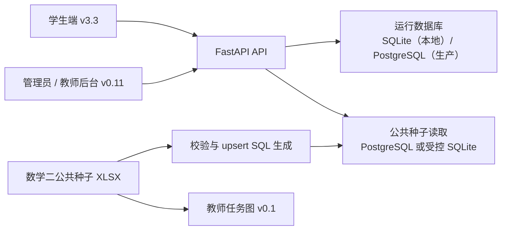

# 系统架构

## 运行关系

## 静态边界

FastAPI 仅挂载：

| URL | 目录 | 说明 |
| --- | --- | --- |
| `/`、`/prototype` | `prototypes/student-mobile-v3.3/` | 学生端 |
| `/assets` | `prototypes/student-mobile-v3.3/assets/` | 学生端运行资源 |
| `/styles` | `prototypes/student-mobile-v3.3/styles/` | 学生端样式 |
| `/admin-console` | `prototypes/admin-teacher-console-v0.1/` | 管理员/教师后台 |
| `/uploads/announcements` | 服务器运行时上传目录 | 公告附件 |

`data/`、`deploy/`、`docs/` 和服务器环境文件不作为静态目录公开。

## 数据分层

| 层 | 内容 | 生产策略 |
| --- | --- | --- |
| 公共种子 | 章节、题型、题目、书目、学校和班级基础配置 | 审阅后显式导入 PostgreSQL |
| 运行数据 | 用户、档案、计划、反馈、专注、会话和审计日志 | 仅由生产 PostgreSQL 持有 |
| 合成样例 | 本地开发账号、计划和统计 | 不得混入真实数据 |
| 前端体验数据 | 无身份的“立即体验”静态数据 | 只用于未登录预览 |

## 鉴权边界

- 学生、教师、管理员共享登录入口，但按角色进入不同页面和 API 权限。
- 学生会话绑定设备；教师只访问授权班级范围。
- 管理员高风险操作需要近期 TOTP 授权。
- 生产管理员初始口令只从环境变量读取。

## 部署边界

初次部署可以创建 schema 和导入公共种子；已有正式数据的普通更新只切换程序 release，不重建数据库。详见 [生产安全更新手册](../deploy/production-safe-update-runbook.md)。
