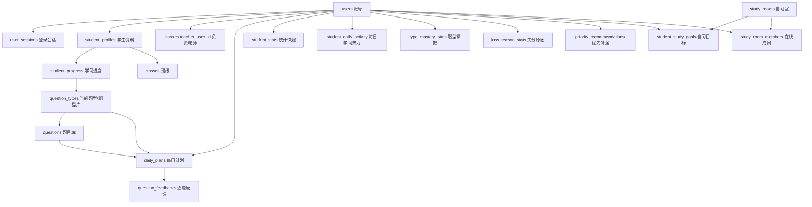

# 样例数据表说明

本文档说明 `data/samples/` 下用于跑通督学网站 MVP 的 16 张运行样例表。以后只要修改任一表的字段、字段含义、枚举值或表间关联关系，都要同步更新本文档。

原始参考表 `sample.xlsx` 不属于这 16 张运行表，它保留为早期题型/题目资料来源参考。

## 总览

| 表 | 行数 | 主要用途 |
| --- | ---: | --- |
| `users.xlsx` | 24 | 统一登录账号表，学生、老师、管理员都在这里登录 |
| `user_sessions.xlsx` | 24 | 登录会话表，用于保持登录状态，并限制同一账号只允许一个设备在线 |
| `student_profiles.xlsx` | 22 | 学生业务资料和服务权益，控制每日计划是否激活 |
| `student_progress.xlsx` | 22 | 学生学习进度指针，记录当前布置到哪个题型以及未作遗留 |
| `classes.xlsx` | 5 | 班级/群组信息，关联负责老师 |
| `question_types.xlsx` | 64 | 题型库，来自“强化题型分类- 副本.xlsx”，决定学习单元、排序、讲解图片、建议时长和能力曲线诊断题型 |
| `questions.xlsx` | 955 | 题目库，来自“强化题型分类- 副本.xlsx”，决定每个题型下展示哪些题号 |
| `daily_plans.xlsx` | 110 | 每日计划明细，一行对应某学生某天计划中的一道题 |
| `question_feedbacks.xlsx` | 0 | 学生提交的逐题反馈，记录正确、错误、未作 |
| `student_stats.xlsx` | 22 | 学生统计快照，用于排行榜和能力曲线展示 |
| `student_daily_activity.xlsx` | 14 | 近 14 天学习热力图、学习打卡和自习完成情况 |
| `type_mastery_stats.xlsx` | 9 | 题型掌握度列表 |
| `loss_reason_stats.xlsx` | 4 | 失分原因图 |
| `priority_recommendations.xlsx` | 3 | 最该优先补强题型 |
| `study_rooms.xlsx` | 2 | 自习室房间信息和在线人数 |
| `student_study_goals.xlsx` | 3 | 今日自习目标、已完成时长、当前专注任务 |
| `study_room_members.xlsx` | 5 | 自习室在线同桌陪伴列表 |

## 核心业务关系



最重要的主线：

1. 用户从 `users` 登录。
2. 系统用 `users.current_session_id` 和 `user_sessions` 判断是否保持登录、是否被新设备挤下线。
3. 如果是学生，读取 `student_profiles` 判断是否能生成今日计划。
4. 今日计划从 `student_progress.current_type_id` 开始，结合 `question_types` 和 `questions` 生成 `daily_plans`。
5. 学生提交做题结果后写入 `question_feedbacks`。
6. 排行榜、能力曲线等展示优先读 `student_stats`、`student_daily_activity`、`type_mastery_stats`、`loss_reason_stats` 和 `priority_recommendations`。
7. 自习室页读取 `study_rooms`、`student_study_goals` 和 `study_room_members`。

## 1. users.xlsx

统一登录账号表。学生、老师、管理员都在这里，不单独做老师登录表。

字段：

| 字段 | 含义 |
| --- | --- |
| `user_id` | 用户唯一 ID，其他表关联这个字段 |
| `login_account` | 登录账号 |
| `password_hash` | 密码哈希。样例中是占位值，正式系统要用真实加密哈希 |
| `login_password` | 本地联调用明文密码。当前所有样例账号为 `123456`，正式上线前应移除或改为安全哈希校验 |
| `role` | 账号角色：`student`、`teacher`、`admin` |
| `nickname` | 页面展示昵称 |
| `avatar_url` | 头像路径 |
| `QQ` | QQ 号，不拆成手机号 |
| `account_status` | 账号状态：`active`、`paused`、`disabled` |
| `current_session_id` | 当前唯一有效登录会话 ID，用于限制一个账号只允许一个设备在线 |
| `last_login_at` | 最近一次成功登录时间 |
| `created_at` | 账号创建时间 |
| `updated_at` | 账号最后修改时间 |

关键逻辑：

- 老师和管理员也走 `users` 登录。
- `role=teacher` 或 `role=admin` 的账号可以进入后台。
- `account_status != active` 时，不应允许正常登录或继续使用。
- `account_status = active` 但 `student_profiles.paid_until < 今日日期` 时，允许登录，但今日计划页应提示服务已到期，不开放题型和反馈提交。
- `current_session_id` 必须指向 `user_sessions.session_id` 中未失效的一条记录。

## 2. user_sessions.xlsx

登录会话表，用来实现“同一设备免重复登录；换设备登录后旧设备退出”。

字段：

| 字段 | 含义 |
| --- | --- |
| `session_id` | 会话唯一 ID |
| `user_id` | 所属用户，关联 `users.user_id` |
| `refresh_token_hash` | 长期登录 token 的哈希值，样例为占位值 |
| `device_id` | 设备标识 |
| `device_name` | 后台可读的设备名称 |
| `ip_address` | 最近登录 IP |
| `user_agent` | 浏览器/系统信息 |
| `expires_at` | 会话过期时间 |
| `revoked_at` | 会话失效时间；为空表示未被主动挤下线 |
| `created_at` | 会话创建时间 |
| `updated_at` | 会话最后修改时间 |

关键逻辑：

- 用户登录成功后，创建一条新的 `user_sessions`。
- 同时更新 `users.current_session_id = 新 session_id`。
- 同一账号换设备登录时，把旧会话的 `revoked_at` 写上时间，再把 `users.current_session_id` 指向新会话。
- 浏览器再次打开网站时，后端校验：token 对应的 `session_id` 是否等于 `users.current_session_id`，且 `revoked_at` 是否为空，且未过期。

## 3. student_profiles.xlsx

学生业务资料和服务权益表。只有学生账号有对应记录。

字段：

| 字段 | 含义 |
| --- | --- |
| `user_id` | 学生用户 ID，关联 `users.user_id` |
| `math_type` | 数学类型，例如 `数学一`、`数学二` |
| `target_exam_year` | 目标考研年份 |
| `target_exam_date` | 目标考试日期，用于倒计时 |
| `target_score` | 目标分数 |
| `class_id` | 所属班级，关联 `classes.class_id` |
| `level` | 学生层级，例如 A/B |
| `plan_enabled` | 是否启用每日计划：`1` 启用，`0` 停用 |
| `paid_until` | 服务到期日期。老师后台主要修改这个字段 |
| `primary_book_1` | 主选书 1 |
| `primary_book_2` | 主选书 2 |
| `backup_book` | 备选书 |
| `current_type_id` | 当前应推进的题型，关联 `question_types.type_id` |
| `current_stage` | 当前学习阶段，例如 `强化` |
| `last_plan_date` | 最近生成计划日期 |
| `created_at` | 学生资料创建时间 |
| `updated_at` | 学生资料最后修改时间 |

计划激活判断建议：

```text
users.account_status = active
student_profiles.plan_enabled = 1
student_profiles.paid_until >= 今日日期
```

老师后台调整学生服务期限时，主要修改 `paid_until`。如果要手动暂停学生计划，可以修改 `plan_enabled`。

## 4. student_progress.xlsx

学生学习进度指针表。`student_profiles` 负责学生身份、班级、书籍和服务权益；`student_progress` 只负责“学到哪里了”。

字段：

| 字段 | 含义 |
| --- | --- |
| `progress_id` | 进度记录 ID |
| `user_id` | 学生用户 ID，关联 `users.user_id` |
| `math_type` | 数学类型快照 |
| `plan_stage` | 当前计划阶段，例如 `强化` |
| `current_type_id` | 当前应继续布置的题型，关联 `question_types.type_id` |
| `current_type_sort_code` | 当前题型排序码，便于排查进度 |
| `progress_status` | 进度状态：`active`、`paused`、`completed` |
| `last_generated_plan_date` | 最近一次生成每日计划的日期 |
| `last_completed_type_id` | 最近完成的题型 |
| `unfinished_type_id` | 存在未作遗留时锁定的题型 |
| `unfinished_question_ids` | 未作题目 ID 列表，MVP 先用 JSON 字符串保存 |
| `created_at` | 创建时间 |
| `updated_at` | 最后修改时间 |

关键逻辑：

- 每日计划从 `student_progress.current_type_id` 开始，按 `question_types.sort_code` 连续向后生成。
- 如果学生提交反馈时有 `未作`，`current_type_id` 不前进，并把未作题写入 `unfinished_question_ids`。
- 如果当前题型无未作，`current_type_id` 前进到当日下一个题型；当日全部完成后，前进到全局下一个可布置题型。

## 4. classes.xlsx

班级/群组信息表。

当前样例中数学二班级按层级和序号组织：

| class_id | 班级 |
| --- | --- |
| `A201` | 26考研数学二A01班 |
| `A202` | 26考研数二A02班 |
| `B201` | 26考研数学二B01班 |
| `B202` | 26考研数学二B02班 |

命名口径：`A/B` 表示学生层级，`2` 表示数学二，最后两位表示同层级下的群序号。A 等级后续可以继续增加 `A203`、`A204`，对应 A03、A04。

字段：

| 字段 | 含义 |
| --- | --- |
| `class_id` | 班级 ID |
| `class_name` | 班级名称 |
| `math_type` | 班级对应数学类型 |
| `target_exam_year` | 班级对应考试年份 |
| `level` | 班级层级 |
| `teacher_user_id` | 负责老师，关联 `users.user_id`，该用户应为 `role=teacher` |
| `group_name` | QQ/社群名称 |
| `created_at` | 班级创建时间 |
| `updated_at` | 班级最后修改时间 |

关键逻辑：

- `student_profiles.class_id` 指向本表。
- 排行榜优先按同班级或同班型展示。
- 老师后台可通过 `teacher_user_id` 找到自己负责的班级和学生。

## 5. question_types.xlsx

题型库。决定学生每天看到的学习单元、排序、讲解图片和建议学习时长。

字段：

| 字段 | 含义 |
| --- | --- |
| `type_id` | 题型唯一 ID |
| `sort_code` | 排序码，每日计划按它向后推进 |
| `subject` | 科目，例如高等数学 |
| `chapter_id` | 大章节 ID |
| `chapter_name` | 大章节名称 |
| `content_block` | 内容板块：知识点、父级题型、子题型等 |
| `type_name` | 题型名称，学生端展示 |
| `parent_type_id` | 父级题型 ID |
| `suggested_days` | 建议学习时长，生成计划时凑近 1 天 |
| `direct_assignable` | 是否可直接布置给学生：`1` 是，`0` 否 |
| `lecture_image_url` | 原创题型讲解图片路径 |
| `input_note` | 后台维护说明 |

关键逻辑：

- `student_progress.current_type_id` 指向当前应继续的题型。
- `questions.type_id` 指向本表。
- `daily_plans.type_id` 是当天计划中实际布置的题型。
- `direct_assignable=0` 的父级题型不应直接展示为反馈题型。

## 6. questions.xlsx

题目库。学生端不展示完整题面，只展示资料来源和原书位置。

字段：

| 字段 | 含义 |
| --- | --- |
| `question_id` | 题目唯一 ID |
| `type_id` | 所属题型，关联 `question_types.type_id` |
| `type_name_check` | 题型名称核对用 |
| `question_note` | 后台备注 |
| `applicable_levels` | 适用层级，例如 `A,B,C,D` |
| `plan_stage` | 适用学习阶段 |
| `source` | 资料来源，例如 `880`、`1000` |
| `original_position_text` | 学生端展示的原书位置 |
| `question_order` | 题型内排序 |
| `display_permission` | 展示权限，当前为 `仅显示题号` |

关键逻辑：

- 生成计划时，根据学生 `level`、`current_stage`、主选书和当前题型筛选题目。
- 学生端只展示 `source` 和 `original_position_text`，不展示第三方教材完整题面。

## 7. daily_plans.xlsx

每日计划明细表。一行表示某学生某天计划中的一道题。

字段：

| 字段 | 含义 |
| --- | --- |
| `plan_id` | 每日计划 ID，同一学生同一天多道题共用同一个 `plan_id` |
| `user_id` | 学生用户 ID，关联 `users.user_id` |
| `plan_date` | 计划日期 |
| `plan_status` | 计划状态：`in_progress`、`completed`、`blocked_by_unfinished` 等 |
| `slogan` | 今日励志话术 |
| `exam_date` | 考试日期 |
| `days_to_exam` | 距离考试天数 |
| `type_index` | 当日第几个题型 |
| `type_id` | 题型 ID，关联 `question_types.type_id` |
| `type_name` | 题型名称快照 |
| `question_id` | 题目 ID，关联 `questions.question_id` |
| `source` | 资料来源快照 |
| `original_position_text` | 原书位置展示文本快照 |
| `question_order` | 题型内题目排序 |
| `feedback_open_status` | 反馈开放状态：`open`、`locked`、`submitted` |
| `created_at` | 计划生成时间 |
| `updated_at` | 计划最后修改时间 |

关键逻辑：

- 今日计划页顶部按 `type_index` 和 `question_order` 展示当天全部题型和题号。
- 反馈区只开放 `feedback_open_status=open` 的当前题型。
- 如果当前题型存在未作，后续题型保持 `locked`。
- `type_name`、`source`、`original_position_text` 是快照字段，避免题库后来修改后影响当天已生成计划。

## 8. question_feedbacks.xlsx

逐题反馈表。学生提交正确、错误、未作后写入。

字段：

| 字段 | 含义 |
| --- | --- |
| `feedback_id` | 反馈记录 ID |
| `plan_id` | 所属每日计划，关联 `daily_plans.plan_id` |
| `user_id` | 学生用户 ID |
| `plan_date` | 计划日期 |
| `type_id` | 题型 ID |
| `question_id` | 题目 ID |
| `result` | 反馈结果：`correct`、`wrong`、`unattempted` |
| `is_wrong_record` | 是否计入错题：错误和未作都为 `1` |
| `is_unfinished_blocker` | 是否阻断今日后续题型，未作为 `1` |
| `submitted_at` | 学生提交时间 |
| `created_at` | 反馈记录创建时间 |
| `updated_at` | 反馈记录最后修改时间 |

关键逻辑：

- 正确率 = `correct` 数量 / 当前题型提交题目总数。
- `wrong` 计入错题，但不阻断后续题型。
- `unattempted` 按错误计入正确率，并阻断当天后续题型。
- 已提交后学生端默认不允许自行修改；如需更正，后续由老师后台处理。

## 9. student_stats.xlsx

学生统计快照表，用于排行榜和能力曲线的快速展示。

字段：

| 字段 | 含义 |
| --- | --- |
| `user_id` | 学生用户 ID |
| `stat_date` | 统计日期 |
| `continuous_days` | 连续学习天数 |
| `today_completion_rate` | 今日完成率 |
| `weekly_completion_rate` | 本周完成率 |
| `overall_accuracy` | 综合正确率 |
| `repeat_wrong_rate` | 复错率 |
| `current_badge_name` | 当前勋章 |
| `next_badge_target` | 下一枚勋章目标 |
| `badge_progress_value` | 勋章进度值 |
| `badge_progress_rate` | 勋章进度比例 |
| `rank_in_class` | 班内排名 |
| `updated_at` | 统计最后更新时间 |

关键逻辑：

- 排行榜不按正确率公开排名，主要看连续学习天数和完成情况。
- 能力曲线可先展示 `overall_accuracy`、`repeat_wrong_rate`、`weekly_completion_rate` 等快照指标。
- 真实系统中，这张表可以由 `daily_plans` 和 `question_feedbacks` 定时聚合生成。

## 10. student_daily_activity.xlsx

学生每日学习活动表，用于能力曲线页的近 14 天学习热力图，也可辅助排行榜页的近 14 天打卡。

字段：

| 字段 | 含义 |
| --- | --- |
| `activity_id` | 每日活动记录 ID |
| `user_id` | 学生用户 ID |
| `activity_date` | 学习日期 |
| `is_studied` | 当天是否学习：`1` 是，`0` 否 |
| `intensity_level` | 学习强度：`high`、`medium`、`low`、`none` |
| `target_minutes` | 当日目标学习分钟数 |
| `completed_minutes` | 当日已完成学习分钟数 |
| `completed_questions` | 当日完成题目数 |
| `submitted_type_count` | 当日提交题型数量 |
| `checkin_status` | 打卡状态：`checked`、`not_checked` |
| `created_at` | 记录创建时间 |
| `updated_at` | 记录最后修改时间 |

关键逻辑：

- `curve-reference.png` 中“最近14天学习热力图”读取本表。
- `intensity_level=high/medium/low/none` 对应热力图颜色深浅。
- 排行榜页“近14天学习打卡”也可以用 `is_studied` 或 `checkin_status` 渲染。

## 11. type_mastery_stats.xlsx

题型掌握度统计表，用于能力曲线页右侧的题型掌握度列表。

字段：

| 字段 | 含义 |
| --- | --- |
| `mastery_id` | 掌握度记录 ID |
| `user_id` | 学生用户 ID |
| `stat_date` | 统计日期 |
| `type_id` | 题型 ID，优先关联 `question_types.type_id`；扩展题型可先作为统计标签存在 |
| `type_name` | 题型名称 |
| `mastery_rate` | 掌握度比例，例如 `0.84` |
| `status_tag` | 掌握状态，例如 `良好`、`待提升`、`薄弱项` |
| `submitted_question_count` | 已提交题目数 |
| `wrong_question_count` | 错题数 |
| `sort_order` | 页面展示顺序 |
| `updated_at` | 统计最后更新时间 |

关键逻辑：

- `curve-reference.png` 中“题型掌握度”读取本表。
- 掌握度可由 `question_feedbacks` 聚合得到，但 MVP 可先用本表作为展示快照。

## 12. loss_reason_stats.xlsx

失分原因统计表，用于能力曲线页的失分原因环形图。

字段：

| 字段 | 含义 |
| --- | --- |
| `loss_reason_id` | 失分原因记录 ID |
| `user_id` | 学生用户 ID |
| `stat_date` | 统计日期 |
| `reason_code` | 原因编码 |
| `reason_name` | 原因名称 |
| `reason_rate` | 占比，例如 `0.32` |
| `wrong_question_count` | 对应错题数 |
| `sort_order` | 页面展示顺序 |
| `updated_at` | 统计最后更新时间 |

关键逻辑：

- `curve-reference.png` 中“失分原因分析”读取本表。
- 当前样例包含：方法选择错误、计算失误、概念混淆、漏条件。

## 13. priority_recommendations.xlsx

优先补强建议表，用于能力曲线页底部“最该优先补强”。

字段：

| 字段 | 含义 |
| --- | --- |
| `recommendation_id` | 建议记录 ID |
| `user_id` | 学生用户 ID |
| `stat_date` | 统计日期 |
| `priority_rank` | 优先级排名 |
| `type_id` | 题型 ID |
| `type_name` | 题型名称 |
| `tag` | 标签，例如 `薄弱项`、`待提升` |
| `reason_text` | 为什么优先补强 |
| `suggested_action` | 建议动作 |
| `icon_key` | 前端图标类型 |
| `updated_at` | 最后更新时间 |

关键逻辑：

- 可以由 `type_mastery_stats`、`loss_reason_stats` 和错题记录聚合生成。
- MVP 可先直接读取本表展示前三项。

## 14. study_rooms.xlsx

自习室房间表，用于自习室首页顶部卡片。

字段：

| 字段 | 含义 |
| --- | --- |
| `room_id` | 自习室 ID |
| `room_name` | 自习室名称 |
| `math_type` | 数学类型 |
| `target_exam_year` | 考试年份 |
| `online_count` | 当前在线人数展示值 |
| `quiet_mode_enabled` | 是否安静模式：`1` 是，`0` 否 |
| `room_rule` | 房间规则文案 |
| `created_at` | 房间创建时间 |
| `updated_at` | 房间最后更新时间 |

关键逻辑：

- `study-room-reference.png` 中“数学二冲刺自习室”“在线128人”“安静模式”“房间规则”读取本表。
- 真实系统中 `online_count` 可以由 `study_room_members` 聚合，也可以保留为缓存字段。

## 15. student_study_goals.xlsx

学生每日自习目标表，用于自习室页的本轮专注、当前任务、今日目标和已完成。

字段：

| 字段 | 含义 |
| --- | --- |
| `goal_id` | 自习目标记录 ID |
| `user_id` | 学生用户 ID |
| `study_date` | 自习日期 |
| `room_id` | 所在自习室，关联 `study_rooms.room_id` |
| `target_minutes` | 今日目标自习分钟数 |
| `completed_minutes` | 今日已完成分钟数 |
| `completion_rate` | 完成比例 |
| `current_focus_minutes` | 当前这一轮已专注分钟数 |
| `current_task_type_id` | 当前任务题型 ID |
| `current_task_name` | 当前任务展示名称 |
| `focus_status` | 专注状态：`focusing`、`idle`、`finished` |
| `current_round_started_at` | 当前专注轮开始时间 |
| `created_at` | 记录创建时间 |
| `updated_at` | 记录最后更新时间 |

关键逻辑：

- `study-room-reference.png` 中“本轮专注 45:00”“当前任务”“今日自习目标 3.0 小时”“已完成 1.5 小时”读取本表。
- `target_minutes=180`、`completed_minutes=90` 可展示为 3.0 小时和 1.5 小时，完成率 50%。

## 16. study_room_members.xlsx

自习室在线成员表，用于“同桌陪伴”列表。

字段：

| 字段 | 含义 |
| --- | --- |
| `room_member_id` | 房间成员记录 ID |
| `room_id` | 自习室 ID |
| `user_id` | 在线用户 ID |
| `online_status` | 在线状态，例如 `online`、`offline` |
| `current_task_name` | 当前正在做的任务文案 |
| `focused_minutes_today` | 今日已专注分钟数 |
| `last_seen_at` | 最近在线时间 |
| `created_at` | 进入房间时间 |
| `updated_at` | 记录最后更新时间 |

关键逻辑：

- `study-room-reference.png` 中“同桌陪伴”头像列表读取本表，并联查 `users.nickname`、`users.avatar_url`。
- `study_rooms.online_count` 可以是本表在线人数的缓存值。

## 常用业务查询路径

### 学生打开今日计划页

```text
users
  -> 校验 account_status、current_session_id
student_profiles
  -> 校验 plan_enabled、paid_until、class_id
student_progress
  -> 读取 current_type_id、unfinished_type_id、unfinished_question_ids
daily_plans
  -> 若当天已有快照，读取该 user_id + plan_date 的全部题目；若没有，则按 student_progress 生成并冻结
question_types
  -> 补充题型讲解图片、题型排序信息
questions
  -> 必要时补充题目来源和展示文本
question_feedbacks
  -> 判断哪些题型已提交、正确率是多少
```

### 老师后台调整学生到期时间

```text
users
  -> 老师登录，role=teacher 或 admin
classes
  -> 找到老师负责班级
student_profiles
  -> 修改学生 paid_until 或 plan_enabled
```

### 同账号换设备登录

```text
users
  -> 找到账号
user_sessions
  -> 将旧 session.revoked_at 写入当前时间
user_sessions
  -> 创建新 session
users
  -> current_session_id 改为新 session_id
```

### 学生提交当前题型反馈

```text
daily_plans
  -> 找到当前 open 的题型和题目
question_feedbacks
  -> 写入每道题 correct / wrong / unattempted
daily_plans
  -> 当前题型改为 submitted
daily_plans
  -> 若无 unattempted，开放下一个题型；若有 unattempted，锁定后续题型
student_progress
  -> 同步 current_type_id、last_completed_type_id、unfinished_question_ids
student_stats
  -> 更新完成率、连续天数、正确率等展示快照
前端
  -> 接收接口返回的最新 dailyPlan，重新渲染今日计划页
```

### 学生打开能力曲线页

```text
student_profiles
  -> 读取目标分数
student_stats
  -> 读取综合正确率、复错率、本周完成率
student_daily_activity
  -> 读取最近14天学习热力图
type_mastery_stats
  -> 读取题型掌握度
loss_reason_stats
  -> 读取失分原因图
priority_recommendations
  -> 读取最该优先补强题型
```

### 学生打开自习室页

```text
student_profiles
  -> 根据 math_type / target_exam_year 找到自习室
study_rooms
  -> 读取自习室名称、在线人数、安静模式、房间规则
student_study_goals
  -> 读取今日自习目标、已完成、当前专注任务
study_room_members
  -> 读取同桌陪伴在线成员
users
  -> 补充在线成员昵称和头像
```

## 修改表时的同步规则

以后修改样例数据时，按这个顺序检查：

1. 新增、删除或重命名字段：更新本文档对应表的字段说明。
2. 新增枚举值：更新本文档中对应字段的可选值。
3. 修改关联字段：更新“核心业务关系”和“常用业务查询路径”。
4. 修改生成脚本 `scripts/build-sample-data.mjs`：确认本文档里的字段和生成脚本一致。
5. 新增样例表：加入“总览”和对应章节。
6. 修改页面参考图涉及的数据点：检查“常用业务查询路径”是否需要补充。

最容易漏改的地方：

- `users.current_session_id` 与 `user_sessions.session_id`
- `student_profiles.class_id` 与 `classes.class_id`
- `student_progress.current_type_id` 与 `question_types.type_id`
- `questions.type_id` 与 `question_types.type_id`
- `daily_plans.question_id` 与 `questions.question_id`
- `question_feedbacks.plan_id`、`question_feedbacks.question_id` 与 `daily_plans`
- `student_daily_activity.user_id` 与 `users.user_id`
- `type_mastery_stats.user_id`、`loss_reason_stats.user_id`、`priority_recommendations.user_id` 与 `users.user_id`
- `student_study_goals.room_id`、`study_room_members.room_id` 与 `study_rooms.room_id`
